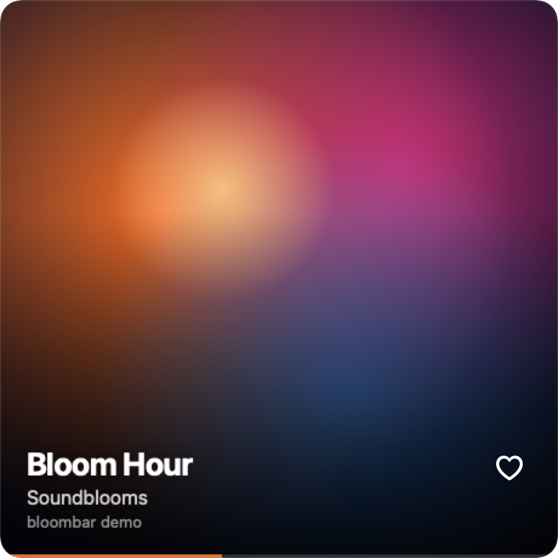
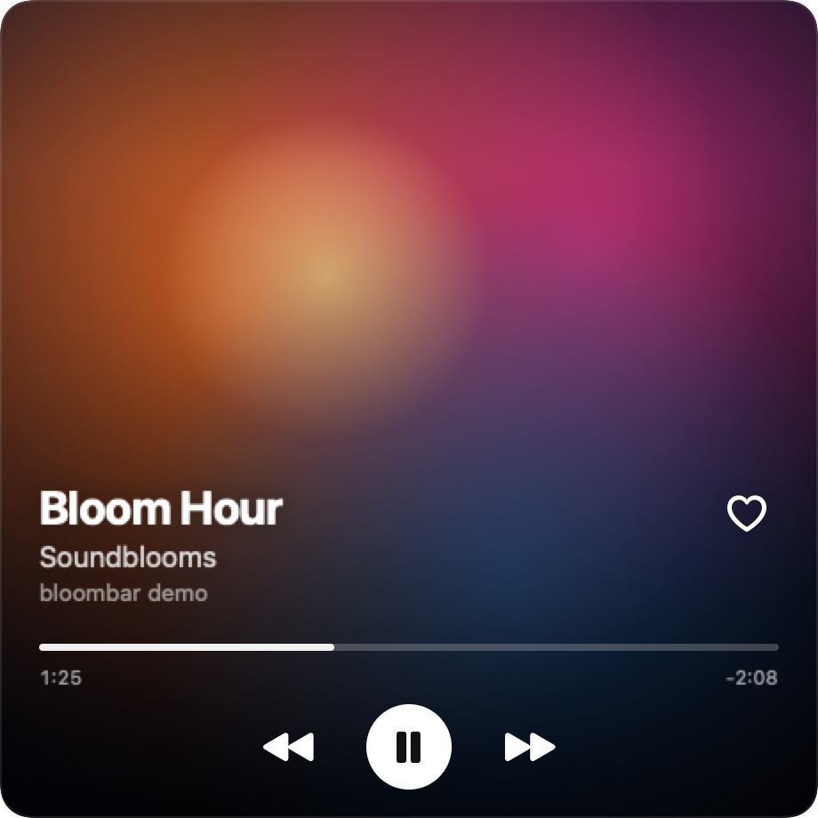

# bloombar

**A menu bar now-playing window for TIDAL on macOS.** The menu bar shows the track that is playing in the TIDAL desktop
app, with a small cover and a thin progress line. Click it and a square window opens with the full-size album cover,
the title, playback controls and a heart that adds the track to your TIDAL favourites.

> **Work in progress - but it works.** I use it every day on my Mac. There is no download yet: you build it from
> source with Apple's free Command Line Tools. Expect rough edges and changes.

<p align="center">
  
  &nbsp;&nbsp;
  
</p>
<p align="center"><sub>Rendered from the app's own view code with a sample track and an abstract placeholder cover.</sub></p>

bloombar is an independent project. It is not affiliated with, endorsed by or connected to TIDAL. TIDAL is a trademark
of its owner and is used here only to say which app bloombar works with.

## What works today

- **Menu bar:** the cover thumbnail, title and artist of the track playing in TIDAL. Under the text runs an orange
  progress line made of thin bars; you can switch it off. A paused track gets a dimmed cover with a pause mark.
- **Poster window:** left click opens a 460 x 460 window with the cover edge to edge (1280 px, the same image TIDAL
  shows), the title, artist and album. Hover it for previous, play/pause, next and a seek bar. Drag it anywhere.
  Esc, a click outside it or another click on the menu bar item hides it.
- **Heart:** log in to TIDAL once and the heart adds the playing track to your TIDAL favourites, or removes it.
- **Right-click menu:** Open TIDAL, Log In to TIDAL / Log Out of TIDAL, Launch at Login, Progress in Menu Bar,
  Quit bloombar.
- **Launch at login:** turned on the first time you start it from `/Applications`, off with one click in the menu.

## What does not work yet

- No ready-made app to download. There is no signed or notarised build; you build it yourself (below).
- Apple Silicon only. The build targets arm64.
- Only what macOS shares about the playing track: title, artist, album, cover, time and play state. No queue, lyrics or
  audio quality.
- The buttons go to whichever app holds the system Now Playing. If Safari or another player takes it over, the
  buttons control that app, while bloombar keeps showing the last TIDAL track.
- The heart needs a free app of your own on developer.tidal.com (see [TIDAL login](#tidal-login-for-the-heart)).
- Less tested so far: the empty state after TIDAL quits, the iTunes cover fallback and launch at login after a
  re-login.
- It depends on a private macOS framework (see below), so a macOS update can break it until the adapter catches up.

## Requirements

- macOS 15 or later on Apple Silicon. Developed and used on macOS 27.
- The TIDAL desktop app (used with version 2.46).
- Xcode Command Line Tools (`xcode-select --install`). Full Xcode is not needed.

## Build and install

```bash
git clone https://github.com/Chronosauros/bloombar.git
cd bloombar
scripts/build-app.sh      # builds build/bloombar.app (and the Now Playing adapter on the first run)
scripts/install.sh        # builds, copies it to /Applications/bloombar.app and starts it
```

The app is signed ad hoc on your Mac, so Gatekeeper does not ask about it. It has no Dock icon; look for the cover and
the track title in the menu bar. If nothing plays in TIDAL, the window says so.

### TIDAL login (for the heart)

Everything except the heart works without logging in. For the heart:

1. Sign in at [developer.tidal.com](https://developer.tidal.com), create an app and copy its Client ID.
2. In that app, add the redirect URI `http://127.0.0.1:53682/callback` and enable the scopes `collection.read`,
   `collection.write` and `search.read`.
3. Copy `app/tidal.local.env.example` to `app/tidal.local.env`, put your Client ID in it and run
   `scripts/install.sh` again.
4. Click the heart (or Log In to TIDAL in the right-click menu). Your browser opens TIDAL's login page; after you
   agree, bloombar takes the answer on `127.0.0.1` and the tab says you can close it.

The login is OAuth with PKCE, so there is no Client Secret anywhere. `app/tidal.local.env` stays out of git.

## How it reads Now Playing

Since macOS 15.4, ordinary apps can no longer read the system Now Playing information, and TIDAL has no AppleScript
or public API for what it is playing. bloombar uses [mediaremote-adapter](https://github.com/ungive/mediaremote-adapter)
by Jonas van den Berg, vendored in `vendor/`. The adapter is a small framework loaded by the system Perl
(`/usr/bin/perl`), which macOS still lets read Now Playing. It streams the playing track as JSON lines, and bloombar
keeps only what comes from TIDAL. The play, pause, next, previous and seek buttons send commands through the same
adapter.

The system gives a 150 px cover, which is too small for the window. bloombar looks up the cover ID of the playing
track in TIDAL's own cache folder and downloads the 1280 px image from TIDAL's image server, with the iTunes Search
API as a fallback.

## Privacy

- No analytics, no accounts of its own, no server of its own.
- It reads the system Now Playing through the adapter, and TIDAL's cache folder
  (`~/Library/Application Support/TIDAL/Cache`) only to find the cover and the track ID of the playing track. It does
  not read TIDAL's tokens, cookies or settings.
- It connects to `resources.tidal.com` for covers and `itunes.apple.com` for the fallback cover (artist and album
  name). After you log in, also to `login.tidal.com`, `auth.tidal.com` and `openapi.tidal.com` for your favourites
  and track search.
- It stores, in `~/Library/Application Support/TidalBar` (a private folder): `tokens.json` with your TIDAL login
  tokens (readable only by you) and `favorites.json` with the IDs of your favourite tracks, so the heart shows the
  right state at once. Log Out of TIDAL deletes both.
- Settings (the progress line switch) are in the app's preferences. Logs go to the macOS unified log on your Mac
  (track names and heart events, never tokens).

The folder name, the bundle ID `io.github.chronosauros.tidalbar` and the `tidalbar://` URL scheme come from the app's
early working name and stay as they are, so existing installs keep their login and settings.

## Licence

bloombar is licensed under the GNU General Public License v3.0 ([LICENSE](LICENSE)). You may use, change and share
it, also commercially, as long as anything you distribute that is based on it stays under GPL-3.0 with its source.

The vendored [mediaremote-adapter](https://github.com/ungive/mediaremote-adapter) is copyright 2025 Jonas van den
Berg and contributors and licensed under the BSD 3-Clause License
([vendor/mediaremote-adapter/LICENSE](vendor/mediaremote-adapter/LICENSE)), which is compatible with GPL-3.0.

Album covers, titles and artist names belong to their rights holders and are shown only as TIDAL provides them.

## Made by Soundblooms

**Soundblooms** - my audio hub, with everything I make in one place - [soundblooms.com](https://soundblooms.com) ·
[Questions or ideas? Come say hi on Discord](https://discord.gg/msgvnUG7js) · more projects on
[GitHub](https://github.com/Chronosauros)

<a href="https://soundblooms.com"></a>
